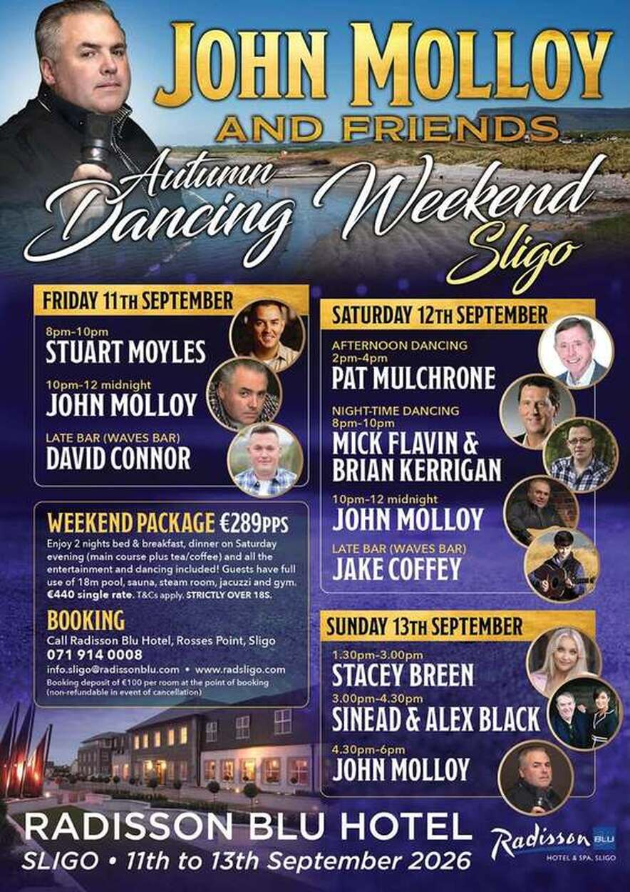
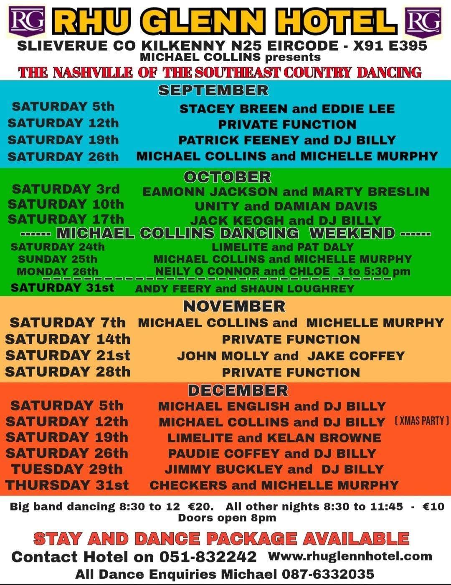
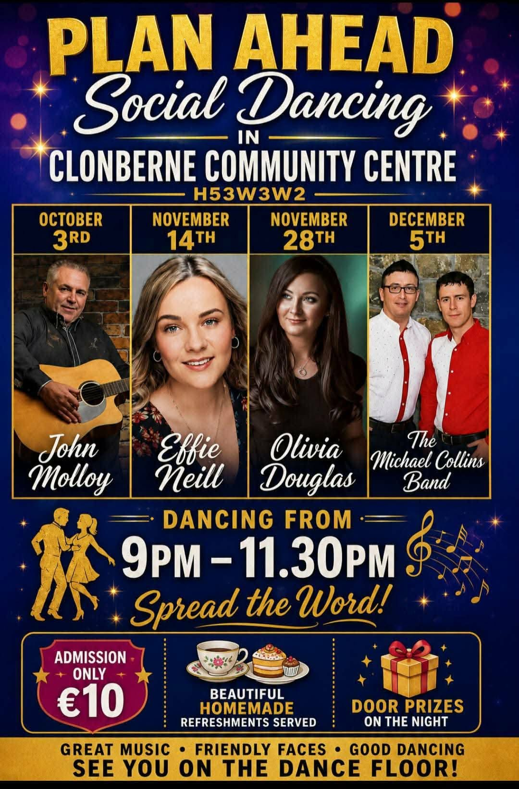
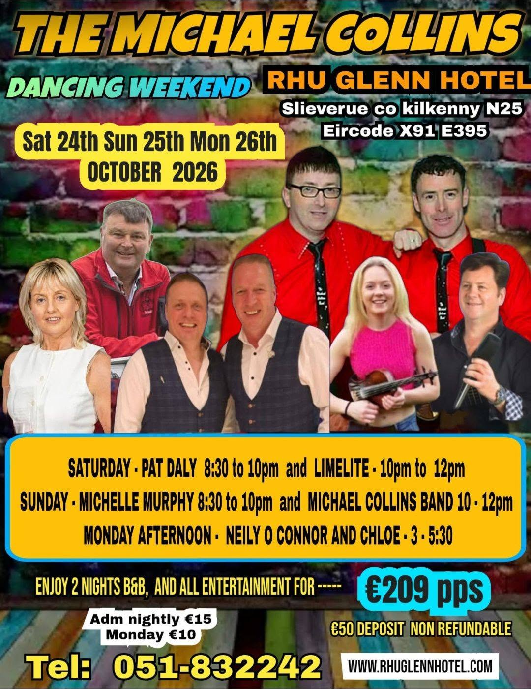
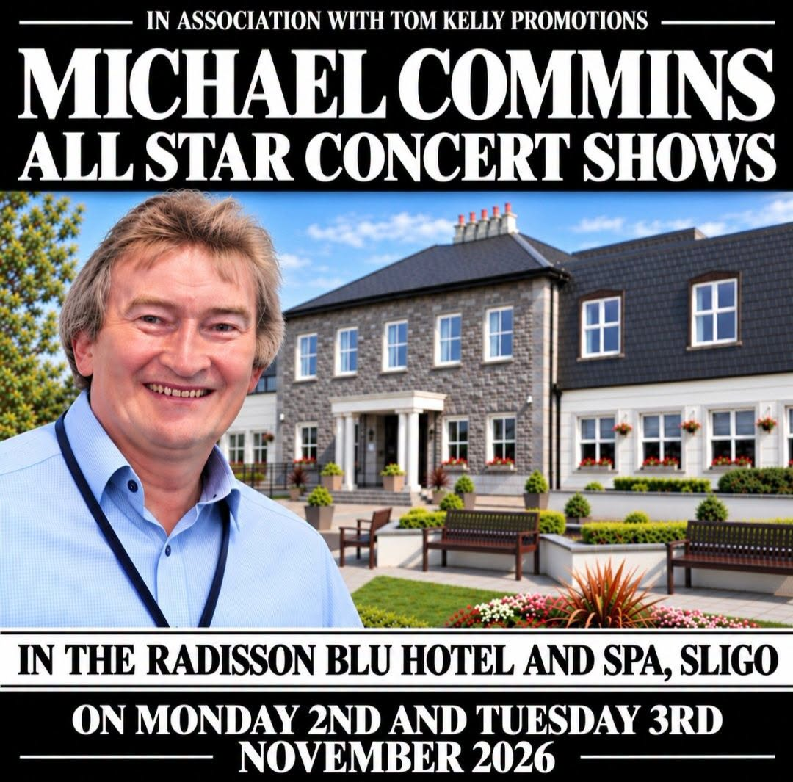
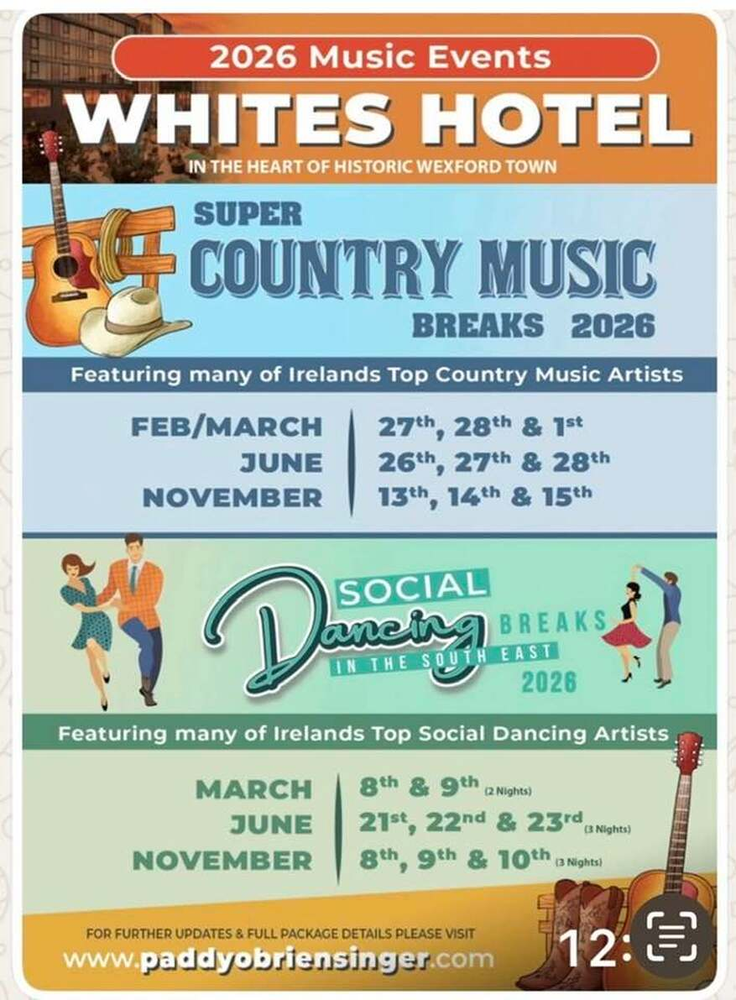
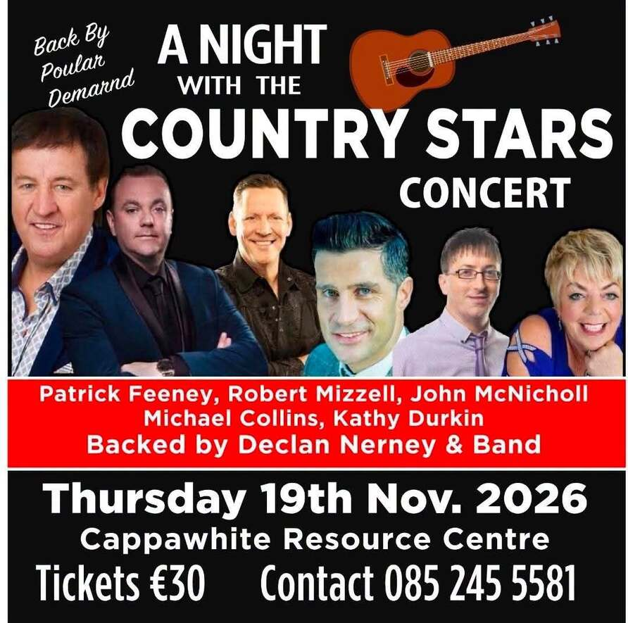
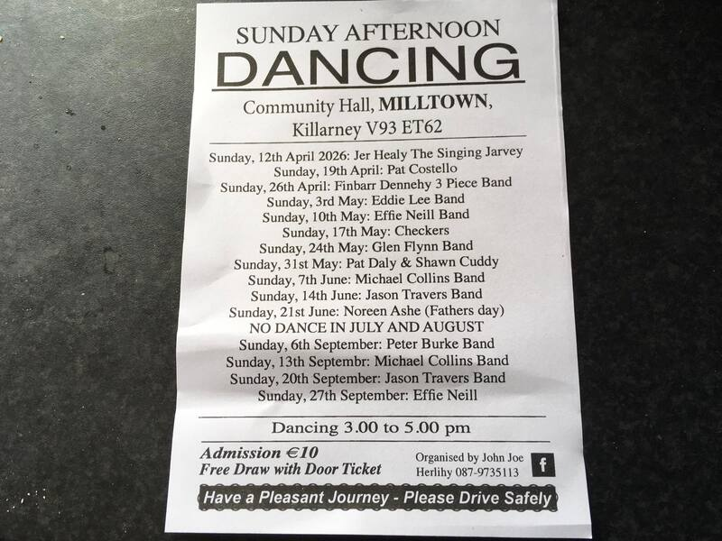

# To approve before launch

Two things only you can settle. Nothing here is live, and I haven't guessed any of it. Reply with changes, or say "all approved".

## 1. Last date for each poster

Give each poster the date of its last gig, or say "No end date". Hidden the day after that date.

| Poster | File | Last date, or "No end date" |
|---|---|---|
|  | sligo-1-copy.jpg | |
|  | rui-glenn-2-copy_orig.jpg | |
|  | social-dancing-1-copy_orig.jpg | |
|  | rui-glenn-2026-copy_orig.jpg | |
|  | michal-commins-nov-1-copy_orig.jpg | |
|  | pob-2026.jpg | |
|  | caroline-night-nov-2026-copy.jpg | |
|  | john-joes-dances-2026.jpg | |

## 2. Master names list

Spellings come from the current site. These are what "Did you mean…?" suggests. He can still add a new name, and you're told when he does.

**Presenters:** Tim Coughlan, George F Langan, Jimmy Reidy, Seán Radley, Breeda, John Nip, Danny Tobin, Willie, Vincent Murray, David Marks, Barry O'Halloran

**Events and acts:** Bumbleance, Glór Tíre, Kildare Goes Country, Farmers Journal Awards, Hot Country Music Awards, Tipp FM Country Music Awards, Caroline's Fundraiser, Rally Cars, Paddy O'Brien, Hugh O'Brien, Liam Cantillon, Pat Daly, Philomena Begley, John McNicholl, Gloria, Heart to Heart, Johnny Bremner, Gina, Dale Haze & The Champions, Caroline Walshe, Danny O'Leary, Lisa McHugh

**Venues:** The Pub, Walter Raleigh Hotel Youghal, Kade's County Glenville, Hazel Tree Mallow, Wallis Arms Hotel Millstreet, The Quays, Galway, Silver Springs Hotel Cork, Cahir House Hotel, The Glen Theatre, Banteer, The Parkway Dunmanway, Lordans, Castleahan, Enniskeane, Startrax, Clonmel Park Hotel Tipperary, Salthill

**Always kept exactly as written:** Normand Boland, Castleahan, Seán Radley, Glór Tíre

**Known misspellings, which prompt "Did you mean…?":**

| He types | Suggested |
|---|---|
| Bumblence | Bumbleance |
| Glor Tire | Glór Tíre |
| Paddy O Brien | Paddy O'Brien |
| Hugh O Brien | Hugh O'Brien |
| Barry O Halloran | Barry O'Halloran |
| Danny O Leary | Danny O'Leary |
| Georges Late Show | George's Late Show |
| Georges Country Corner | George's Country Corner |
| Willies Country Favourites | Willie's Country Favourites |
| Tipp F.M Country Music Award's | Tipp FM Country Music Awards |
| lisaMcHugh | Lisa McHugh |
| Kades Kounty | Kade's County |
| Seamus Fitzsimmon | Seamus Fitzsimmons |

**Not yet approved by you, taken from old file names:** bunblence, mbleance and bumblance, all suggesting Bumbleance.

### Questions on the names

1. Is "Willie" on the schedule the same person as "Willie Fitzgerald" on the Archives page? Should the list use one name?
2. Is "George" in the Archives the same person as "George F Langan"?
3. The Archives title says "Sean Interviews Ger Wolfe", with no fada, while the schedule says Seán. Leave it?
4. "Willie Interviews Louise Morrissey." still ends in a full stop. Leave it?
5. Are "Gloria" and "Gina" right as stand-alone names? They come from album titles such as "Gina, Dale Haze & The Champions".
6. "Normand Boland" and "Seamus Fitzsimmons" were in the interviews you removed, so they're not on the site now. Keep them on the list?
7. Is it right that "Barry O Halloran" and "Danny" are handled like this: the first suggests Barry O'Halloran, and "Danny" on its own just offers Danny Tobin or Danny O'Leary?
